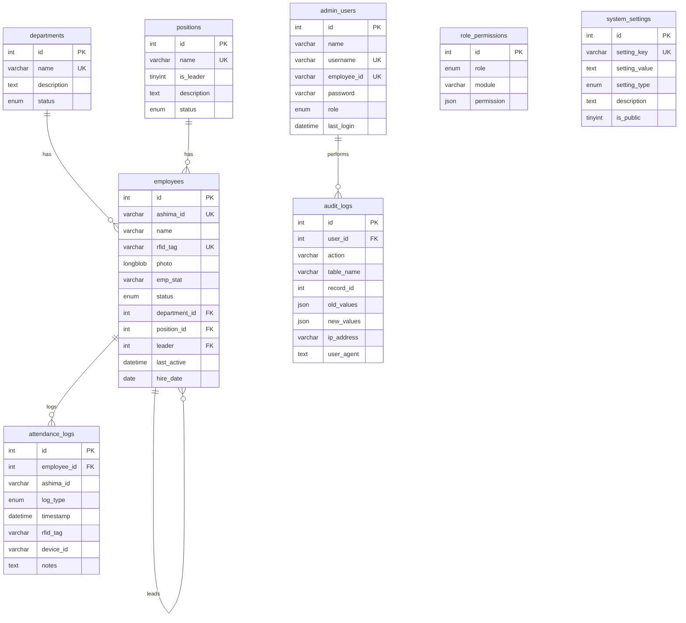

# Database

## Overview

- **Engine**: MySQL (InnoDB)
- **Database name**: `rfid_attendance`
- **Character set**: `utf8mb4` / `utf8mb4_general_ci`
- **Connection**: `mysql2/promise` pool in `lib/db.js` (max 10 connections)
- **Query pattern**: Parameterized queries via `executeQuery({ query, values })`

## Entity Relationship Diagram



## Tables

### `admin_users`

Admin/operator accounts that log into the dashboard.

| Column        | Type                                       | Constraints             | Notes                               |
| ------------- | ------------------------------------------ | ----------------------- | ----------------------------------- |
| `id`          | `INT(11)` AUTO_INCREMENT                   | PRIMARY KEY             |                                     |
| `name`        | `VARCHAR(255)`                              | NOT NULL                | Display name                        |
| `username`    | `VARCHAR(100)`                              | NOT NULL, UNIQUE        | Login identifier                    |
| `employee_id` | `VARCHAR(50)`                               | NOT NULL, UNIQUE        | Ashima ID (e.g., `XX-XXXXX`)       |
| `password`    | `VARCHAR(255)`                              | NOT NULL                | bcrypt hash                         |
| `role`        | `ENUM('superadmin','admin','security','hr')` | NOT NULL, DEFAULT `admin` |                                   |
| `created_at`  | `TIMESTAMP`                                 | DEFAULT `CURRENT_TIMESTAMP` |                                 |
| `updated_at`  | `TIMESTAMP`                                 | ON UPDATE `CURRENT_TIMESTAMP` |                               |
| `last_login`  | `DATETIME`                                  | NULLABLE                | Most recent login timestamp         |

---

### `departments`

Organizational departments.

| Column        | Type                           | Constraints             | Notes             |
| ------------- | ------------------------------ | ----------------------- | ----------------- |
| `id`          | `INT(11)` AUTO_INCREMENT       | PRIMARY KEY             |                   |
| `name`        | `VARCHAR(255)`                  | NOT NULL, UNIQUE        |                   |
| `description` | `TEXT`                          | NULLABLE                |                   |
| `status`      | `ENUM('active','inactive')`    | DEFAULT `active`        |                   |
| `created_at`  | `TIMESTAMP`                     | DEFAULT `CURRENT_TIMESTAMP` |               |
| `updated_at`  | `TIMESTAMP`                     | ON UPDATE `CURRENT_TIMESTAMP` |             |

---

### `positions`

Job positions/titles.

| Column        | Type                           | Constraints             | Notes                              |
| ------------- | ------------------------------ | ----------------------- | ---------------------------------- |
| `id`          | `INT(11)` AUTO_INCREMENT       | PRIMARY KEY             |                                    |
| `name`        | `VARCHAR(255)`                  | NOT NULL, UNIQUE        |                                    |
| `is_leader`   | `TINYINT(1)`                    | DEFAULT `0`             | `1` = leadership position          |
| `description` | `TEXT`                          | NULLABLE                |                                    |
| `status`      | `ENUM('active','inactive')`    | DEFAULT `active`        |                                    |
| `created_at`  | `TIMESTAMP`                     | DEFAULT `CURRENT_TIMESTAMP` |                                |
| `updated_at`  | `TIMESTAMP`                     | ON UPDATE `CURRENT_TIMESTAMP` |                              |

---

### `employees`

All tracked employees.

| Column          | Type                                       | Constraints             | Notes                                  |
| --------------- | ------------------------------------------ | ----------------------- | -------------------------------------- |
| `id`            | `INT(11)` AUTO_INCREMENT                   | PRIMARY KEY             |                                        |
| `ashima_id`     | `VARCHAR(12)`                               | NOT NULL, UNIQUE        | Format: `XX-XXXXX`                    |
| `name`          | `VARCHAR(150)`                              | NOT NULL                |                                        |
| `rfid_tag`      | `VARCHAR(50)`                               | NULLABLE, UNIQUE        | RFID card identifier                   |
| `photo`         | `LONGBLOB`                                  | NULLABLE                | Binary photo data                      |
| `emp_stat`      | `VARCHAR(12)`                               | DEFAULT `Regular`       | Regular, Probationary, etc.            |
| `status`        | `ENUM('active','inactive','resigned')`     | DEFAULT `active`        |                                        |
| `department_id` | `INT(11)`                                   | FK → `departments.id`  | ON DELETE SET NULL                     |
| `position_id`   | `INT(11)`                                   | FK → `positions.id`    | ON DELETE SET NULL                     |
| `leader`        | `INT(11)`                                   | FK → `employees.id`    | Self-referencing; direct supervisor    |
| `last_active`   | `DATETIME`                                  | NULLABLE                |                                        |
| `hire_date`     | `DATE`                                      | NULLABLE                |                                        |
| `created_at`    | `TIMESTAMP`                                 | DEFAULT `CURRENT_TIMESTAMP` |                                    |
| `updated_at`    | `TIMESTAMP`                                 | ON UPDATE `CURRENT_TIMESTAMP` |                                  |

---

### `attendance_logs`

Every check-in/check-out event.

| Column        | Type                                              | Constraints             | Notes                                |
| ------------- | ------------------------------------------------- | ----------------------- | ------------------------------------ |
| `id`          | `INT(11)` AUTO_INCREMENT                          | PRIMARY KEY             |                                      |
| `employee_id` | `INT(11)`                                          | FK → `employees.id`    | ON DELETE CASCADE                    |
| `ashima_id`   | `VARCHAR(20)`                                      | NOT NULL                | Denormalized for backward compat     |
| `log_type`    | `ENUM('time_in','time_out','break_in','break_out')` | NOT NULL              |                                      |
| `timestamp`   | `DATETIME`                                         | DEFAULT `CURRENT_TIMESTAMP` |                                  |
| `rfid_tag`    | `VARCHAR(50)`                                      | NULLABLE                | Tag used for this scan               |
| `device_id`   | `VARCHAR(50)`                                      | NULLABLE                | Scanner device identifier            |
| `notes`       | `TEXT`                                              | NULLABLE                |                                      |
| `created_at`  | `TIMESTAMP`                                         | DEFAULT `CURRENT_TIMESTAMP` |                                  |

---

### `role_permissions`

Module-level access control per role.

| Column       | Type                                       | Constraints             | Notes                                |
| ------------ | ------------------------------------------ | ----------------------- | ------------------------------------ |
| `id`         | `INT(11)` AUTO_INCREMENT                   | PRIMARY KEY             |                                      |
| `role`       | `ENUM('superadmin','admin','security','hr')` | NOT NULL              |                                      |
| `module`     | `VARCHAR(100)`                              | NOT NULL                | e.g., `employees_management`         |
| `permission` | `JSON`                                      | NOT NULL                | e.g., `{"access": true}`            |
| `created_at` | `TIMESTAMP`                                 | DEFAULT `CURRENT_TIMESTAMP` |                                  |
| `updated_at` | `TIMESTAMP`                                 | ON UPDATE `CURRENT_TIMESTAMP` |                                |

**Unique constraint**: `(role, module)`

**Module names**: `employees_management`, `data_management`, `account_logins`, `attendance_logs`, `role_permissions`

---

### `audit_logs`

Tracks admin actions for auditing.

| Column       | Type             | Constraints           | Notes                              |
| ------------ | ---------------- | --------------------- | ---------------------------------- |
| `id`         | `INT(11)` AI     | PRIMARY KEY           |                                    |
| `user_id`    | `INT(11)`         | FK → `admin_users.id`| ON DELETE SET NULL                 |
| `action`     | `VARCHAR(100)`    | NOT NULL              | CREATE, UPDATE, DELETE, LOGIN, etc.|
| `table_name` | `VARCHAR(100)`    | NULLABLE              | Affected table                     |
| `record_id`  | `INT(11)`         | NULLABLE              | Affected record ID                 |
| `old_values` | `JSON`            | NULLABLE              | Previous state                     |
| `new_values` | `JSON`            | NULLABLE              | New state                          |
| `ip_address` | `VARCHAR(45)`     | NULLABLE              | IPv4/IPv6                          |
| `user_agent` | `TEXT`            | NULLABLE              |                                    |
| `created_at` | `TIMESTAMP`       | DEFAULT `CURRENT_TIMESTAMP` |                              |

---

### `system_settings`

Key-value configuration store.

| Column          | Type                                        | Constraints             | Notes                          |
| --------------- | ------------------------------------------- | ----------------------- | ------------------------------ |
| `id`            | `INT(11)` AUTO_INCREMENT                    | PRIMARY KEY             |                                |
| `setting_key`   | `VARCHAR(100)`                               | NOT NULL, UNIQUE        |                                |
| `setting_value` | `TEXT`                                       | NOT NULL                |                                |
| `setting_type`  | `ENUM('string','number','boolean','json')`  | DEFAULT `string`        |                                |
| `description`   | `TEXT`                                       | NULLABLE                |                                |
| `is_public`     | `TINYINT(1)`                                 | DEFAULT `0`             | `1` = accessible by non-admins |
| `created_at`    | `TIMESTAMP`                                  | DEFAULT `CURRENT_TIMESTAMP` |                            |
| `updated_at`    | `TIMESTAMP`                                  | ON UPDATE `CURRENT_TIMESTAMP` |                          |

**Default settings**: `company_name`, `timezone` (Asia/Manila), `attendance_grace_period` (15 min), `max_daily_hours` (8), `enable_photo_capture`, `rfid_scan_timeout` (5000ms)

## Indexes

| Table              | Index Name                          | Columns                          |
| ------------------ | ----------------------------------- | -------------------------------- |
| `attendance_logs`  | `idx_attendance_date`               | `timestamp`                      |
| `attendance_logs`  | `idx_attendance_employee_date`      | `employee_id`, `timestamp`       |
| `employees`        | `idx_employee_name`                 | `name`                           |
| `employees`        | `idx_employee_department_status`    | `department_id`, `status`        |
| `audit_logs`       | `idx_audit_user_action`             | `user_id`, `action`              |
| `audit_logs`       | `idx_audit_table_record`            | `table_name`, `record_id`        |

## Connection Configuration

```javascript
// lib/db.js
const pool = mysql.createPool({
  host: process.env.DB_HOST,
  user: process.env.DB_USER,
  password: process.env.DB_PASSWORD,
  database: process.env.DB_NAME,
  waitForConnections: true,
  connectionLimit: 10,
  queueLimit: 0
});
```

## SQL Files

| File                                 | Purpose                                         |
| ------------------------------------ | ------------------------------------------------ |
| `databases/schema.sql`              | Full schema creation + default seed data          |
| `databases/rfid_attendance.sql`     | Complete database dump (structure + data)         |
| `databases/migration.sql`           | Schema migration scripts                          |
| `databases/dev-setup.sql`           | Development environment seed data                 |
| `databases/role_permissions.sql`    | Role permission seed data                         |
| `databases/migrate_to_access_only.sql` | Migration to simplified access-only permissions |
